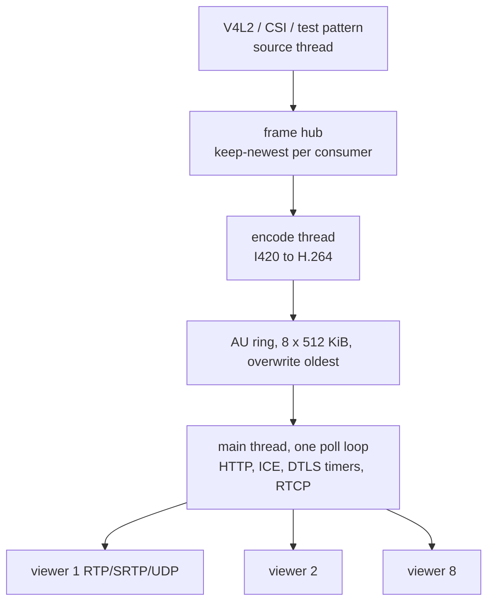
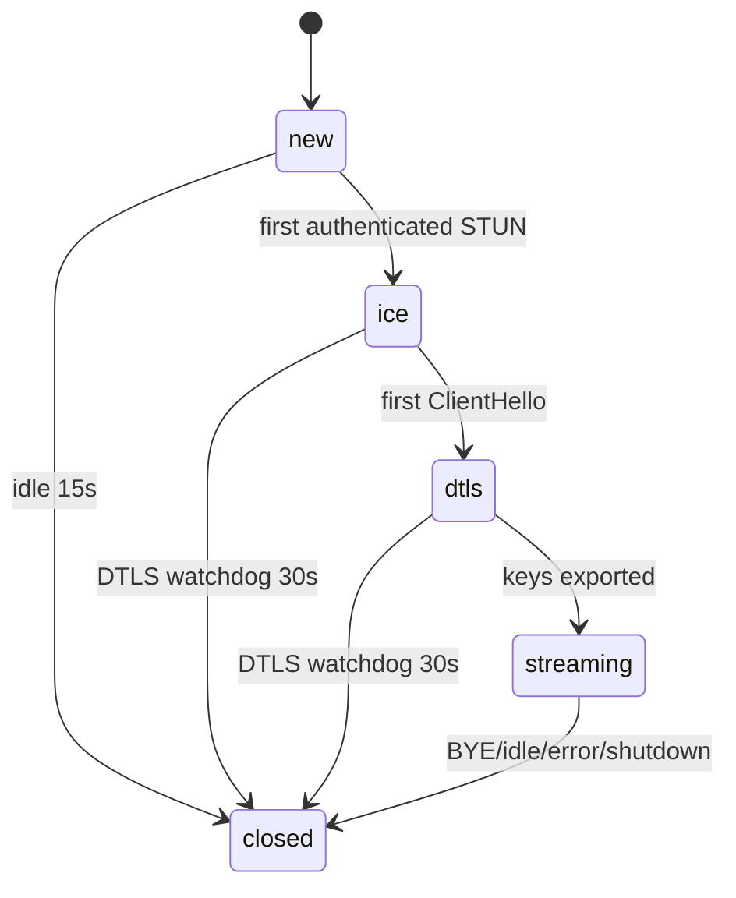

# camstream

WebRTC camera server for Linux, written in C. Captures from a V4L2 or Raspberry Pi CSI camera, encodes H.264 with the V4L2 M2M hardware encoder or libx264, and streams to a browser over WebRTC. LAN only: no cloud, no STUN/TURN server, no JavaScript build step.

The repo also contains `server.c`, a small static HTTP server built on the vendored Mongoose library, which can be reused on its own in other embedded projects.

## Components

- **camstream**: main server with its own WebRTC stack (ICE-lite, DTLS 1.2, SRTP, RTP/RTCP, using OpenSSL and libsrtp2). One thread handles up to 8 viewers.
- **camstream-libpeer**: the same camera pipeline with [sepfy/libpeer](https://github.com/sepfy/libpeer) (pinned at `5b849de`) as the WebRTC stack. Vendored mbedtls/libsrtp2, so no system OpenSSL is needed. One thread per viewer, up to 4 viewers. Exists so the two stacks can be compared and used as fallback for each other.
- **server.c**: standalone static file server (`gcc -O2 -Wall server.c mongoose.c -o web_server`, serves `./web_root` on port 8000). `mongoose.c`/`mongoose.h` at the repo root are symlinks to `third_party/mongoose/`.

## Quick start

Pi with a CSI camera:

```sh
sudo apt update && sudo apt install -y build-essential libssl-dev libsrtp2-dev libx264-dev rpicam-apps
git clone https://github.com/salman-cc/cam.git camstream && cd camstream
make -j4
./build/camstream --source csi --width 1280 --height 720 --fps 30 --encoder auto --listen 0.0.0.0 --http-port 8080
# open http://<pi-ip>:8080/ from a machine on the same LAN
```

libpeer variant:

```sh
git submodule update --init --recursive
sudo apt install -y cmake python3-jsonschema python3-jinja2
make camstream-libpeer -j4
./build/camstream-libpeer --source csi --width 1280 --height 720 --fps 30 --listen 0.0.0.0 --http-port 8080
```

Minimal HTTP server only (no OpenSSL, libsrtp2 or cmake needed):

```sh
gcc -O2 -Wall server.c mongoose.c -o web_server
mkdir -p web_root && echo "hello" > web_root/index.html
./web_server   # http://0.0.0.0:8000 serving ./web_root
```

See [docs/RASPBERRY_PI.md](docs/RASPBERRY_PI.md) for Raspberry Pi notes.

## Building

### Dependencies

| Dependency | Used for | Debian package |
|---|---|---|
| OpenSSL 1.1.1/3.x | DTLS (native stack) | `libssl-dev` |
| libsrtp2 | SRTP (native stack) | `libsrtp2-dev` |
| libx264 | software encoder (both stacks) | `libx264-dev` |
| cmake, python3-jsonschema, jinja2 | building libpeer | `cmake python3-jsonschema python3-jinja2` |
| pthreads, libm | threads, math | libc |
| kernel headers | V4L2 ioctls | `linux-libc-dev` |
| rpicam-apps | CSI capture | `rpicam-apps` |

`camstream-libpeer` does not need OpenSSL or libsrtp2; libpeer vendors mbedtls and libsrtp2.

### Targets

| Target | Effect |
|---|---|
| `make` | `build/camstream` |
| `make camstream-libpeer` | `build/camstream-libpeer` (needs submodule + cmake) |
| `make test` | native stack tests (8 binaries) |
| `make test-libpeer` | libpeer tests (2 binaries) |
| `make install` | install camstream + config + systemd unit |
| `make install-libpeer` | install camstream-libpeer + its unit |
| `make clean` | remove `build/` |
| `make help` | list targets |

`make` looks for dependencies under `DEPS_PREFIX`, then `/usr/local`, then `/usr`; pkg-config is not required.

```sh
make DEPS_PREFIX=/opt/cam        # all deps under one prefix
make X264_DIR=/opt/x264
make HAVE_X264=0                 # build without the software encoder
make OPT="-O3 -march=armv8-a"
```

### Cross compile for Pi 4 (aarch64) from x86_64

Using `zig cc`:

```sh
pip install ziglang
make camstream-libpeer CMAKE=cmake \
  LIBPEER_CMAKE_ARGS="-DCMAKE_TOOLCHAIN_FILE=cmake/zig-aarch64.cmake" \
  CC="zig cc -target aarch64-linux-gnu"
```

The toolchain file is `cmake/zig-aarch64.cmake`.

## Running

```sh
# Test pattern, no camera needed
./build/camstream --test
./build/camstream-libpeer --test -W 640 -H 480 -F 30

# USB camera
./build/camstream --source v4l2 --device /dev/video0 --width 1280 --height 720

# Pi CSI, hardware encoder when available
./build/camstream --source csi --width 1280 --height 720 --fps 30 --encoder auto --listen 0.0.0.0 --http-port 8080
./build/camstream-libpeer --source csi --width 1280 --height 720 --fps 30 --encoder auto --listen 0.0.0.0 --http-port 8080

# From a config file (enables POST /api/config/reload)
./build/camstream --config /etc/camstream.conf
```

If the systemd service is installed, stop it first (`sudo systemctl stop camstream`) or port 8080 will be busy.

Open `http://camstream.local:8080/` or `http://<pi-ip>:8080/`. The server speaks plain HTTP only, so the URL must start with `http://`; a browser forcing `https://` gets a TLS alert on the plain port and shows an error such as `PR_END_OF_FILE_ERROR`.

### CLI options (both binaries)

| Option | Default | Meaning |
|---|---|---|
| `-s, --source KIND` | `v4l2` | `v4l2`, `csi`, `stdin`, `test` |
| `-d, --device PATH` | `/dev/video0` | V4L2 device |
| `-t, --test` | off | shorthand for `--source test` |
| `--stdin-yuv420` | off | `--source stdin` |
| `--rpicam-bin PATH` | autodetect | `rpicam-vid` binary |
| `-W, --width N` | 640 | capture width |
| `-H, --height N` | 480 | capture height |
| `-F, --fps N` | 30 | frame rate |
| `-e, --encoder MODE` | `auto` | `auto`, `hw`, `hw:/dev/videoN`, `sw` |
| `-b, --bitrate KBPS` | 2500 | target bitrate |
| `-K, --keyframe SEC` | 2 | IDR interval |
| `-l, --listen ADDR` | `0.0.0.0` | HTTP bind address |
| `-p, --http-port N` | 8080 | HTTP port |
| `-u, --udp-port N` | 50000 | first UDP media port (native only) |
| `-n, --mdns-name NAME` | `camstream` | published as `NAME.local` |
| `--mdns on|off` | on | mDNS responder |
| `--mdns-port N` | 5353 | responder port |
| `--config PATH` | none | config file |
| `-v, --verbose` | off | DEBUG to stderr and `/api/logs` |

Exits 0 on SIGINT/SIGTERM after closing sessions and freeing DTLS state.

## Configuration

The config file uses the same keys as the CLI, `key = value`. An unknown key or an out-of-range value makes the server refuse to start.

```ini
source = csi
device = /dev/video0
width = 1280
height = 720
fps = 30
encoder = auto
bitrate_kbps = 2500
keyframe_seconds = 2
listen = 0.0.0.0
http_port = 8080
udp_port = 50000
mdns = on
mdns_name = camstream
mdns_port = 5353
verbose = 0
```

`config/camstream.conf` is a commented sample, installed to `/etc/camstream.conf`.

`POST /api/config/reload` re-reads the file. `bitrate_kbps` is applied live (queued to the encode thread); everything else needs a restart. The response lists what was applied and what requires a restart. A broken file leaves the running config untouched.

## Camera setup

USB:

```sh
ls /dev/video* && v4l2-ctl --list-devices
v4l2-ctl -d /dev/video0 --list-formats-ext
./build/camstream --source v4l2 --device /dev/video0
# if not root: sudo usermod -aG video $USER && re-login
```

Pi CSI:

```sh
sudo apt install -y rpicam-apps
rpicam-hello --list-cameras
rpicam-vid -t 2000 -n --width 1280 --height 720 --codec yuv420 -o /dev/null
./build/camstream --source csi --width 1280 --height 720 --fps 30
```

Do not use `--source v4l2 --device /dev/video0` for a CSI camera: that node is the raw Bayer sensor and needs the libcamera pipeline, so it fails with errno 22. Use `csi`.

## Networking

| Port | Proto | Direction | Purpose |
|---|---|---|---|
| 8080 | TCP | browser to server | web UI, `/api/*`, signaling |
| 50000-50007 | UDP | browser to server | STUN, DTLS, SRTP (native, one per viewer) |
| ephemeral | UDP | server side (libpeer) | one per viewer, bound by libpeer |
| 5353 | UDP | both | mDNS `224.0.0.251` |

Any browser with `RTCPeerConnection`, DTLS 1.2 and H.264 works. The page is served over plain HTTP, which is enough because it only receives video and never calls `getUserMedia`.

### mDNS

The server publishes `camstream.local` (configurable with `--mdns-name`) and re-announces it when addresses change. The web page connects automatically (muted video autoplay) and retries failed attempts 5 times with backoff. With no DHCP server (for example a single cable between Pi and laptop) both sides fall back to link-local `169.254.0.0/16` and mDNS still works.

mDNS client support: built in on macOS/iOS, Windows 10 1809+, and Android 12+; on Linux use `resolvectl mdns eth0 yes` or avahi with `libnss-mdns`. Running two servers needs two names; on a conflict the responder probes and renames itself to `camstream-2` up to `camstream-10`.

## Web interface

`web/index.html` (native) and `web/libpeer.html` (libpeer) are plain HTML/CSS/JS embedded into the binary at build time by `tools/embed_assets.c`. The page shows the video, connection state, pipeline layers, camera/encoder state, transport counters (packets, retransmits, NACKs, PLIs, RTT, loss, jitter), CPU/memory and the server log, with buttons for connect/disconnect, camera restart, WebRTC restart and config reload.

## Diagnostics API

| Method | Path | Purpose |
|---|---|---|
| GET | `/` | web UI |
| GET | `/api/status` | subsystem state, counters, interfaces, rates |
| GET | `/api/stats` | transport totals and per-session stats |
| GET | `/api/logs` | log ring, `?limit=1..256&level=debug|warn|info|error` |
| POST | `/api/webrtc/offer` | signaling `{"sdp":"..."}` (native) |
| POST | `/api/webrtc/close` | close session `{"session_id":N}` |
| POST | `/api/webrtc/client-stats` | page reports `frames_decoded` |
| POST | `/api/camera/restart` | rebuild the pipeline |
| POST | `/api/webrtc/restart` | drop sessions, new DTLS cert |
| POST | `/api/config/reload` | re-read the config file |
| POST | `/api/session` | create libpeer session, returns `{"id":N,"sdp":"..."}` |
| POST | `/api/session/answer` | pass the browser answer to libpeer |
| POST | `/api/session/close` | close libpeer session |

Unknown paths get 404, wrong methods 405, malformed bodies 400 with a reason. No endpoint executes shell commands, opens files by name, or restarts the process.

## Architecture

Both binaries share the camera pipeline:



Data flow (native stack):

1. The source thread fills a pooled frame, timestamps it with `CLOCK_MONOTONIC` and publishes it to the hub. The hub keeps the newest frame per consumer, so a slow encoder drops frames instead of letting latency accumulate.
2. The encoder thread converts YUYV/YU12 to I420, encodes Annex B H.264 and pushes access units into the ring. The ring overwrites the oldest slot, so the encoder never blocks on the network.
3. The main thread drains the ring, splits each AU into RTP packets (single NAL or FU-A, max 1200 bytes UDP payload), encrypts with SRTP and sends to each viewer.
4. A 512-packet retransmit cache answers RTCP NACKs without stalling.
5. Sender Reports go out every second so the browser can compute RTT. A viewer joining mid-GOP triggers an IDR request (rate limited to one per 400 ms per session).

The libpeer variant shares everything up to the AU ring, then a media thread fans out to one session thread per viewer (PeerConnection, DTLS, SRTP). Each session mailbox has 8 slots and is flushed on overflow with a resync flag, so a slow viewer never builds up delay and resumes on the next IDR.

One poll loop for all viewers works here because the workload is small: LAN, one operator, up to 8 viewers, a few microseconds per packet, and no locks between packetization, retransmit and RTCP.

### Camera pipeline

| Source | How | Use |
|---|---|---|
| `v4l2` | opens the device, negotiates YUYV/YU12, 4 mmap buffers | USB cameras |
| `csi` | spawns `rpicam-vid --codec yuv420 --flush -o -` and reads the pipe | Pi CSI |
| `stdin` | raw YUV420 from stdin | `ffmpeg ... -f rawvideo -pix_fmt yuv420p -` |
| `test` | synthetic pattern | benchmarking, CI |

CSI chain:

```
IMX219 -> libcamera ISP -> rpicam-vid --codec yuv420 -o - -> pipe -> camstream -> H.264 -> RTP/SRTP -> browser
```

`rpicam-vid` pads luma rows to 64 bytes (chroma to 32); the source reports the stride and the encoder strips the padding. Widths that are a multiple of 64 (640, 1280, 1920) avoid the extra copy. The child is started with `posix_spawn` and close-on-exec file descriptors. EOF, a dead child, a truncated frame or 5 s without data (15 s for the first frame) triggers a pipeline rebuild.

Encoders:

| Mode | Backend | Notes |
|---|---|---|
| `auto` | hardware first, libx264 fallback, plus runtime HW to SW switch | default |
| `hw` | V4L2 M2M `/dev/video11` first, then any M2M device | Pi Zero 2 / 3 / 4 |
| `hw:/dev/video11` | explicit device | unusual numbering |
| `sw` | libx264 | required on Pi 5, which has no hardware H.264 encoder |

libx264 runs with `superfast` + `zerolatency` (no lookahead, no B-frames), sliced threads (up to 4), constrained baseline, CBR-like VBV (max bitrate = target, 0.5 s buffer), fixed GOP, SPS/PPS on every IDR.

The hardware backend sets the real capture format before enabling the port. Earlier revisions left it at 0x0, which `bcm2835-codec` accepted at `S_FMT` but rejected with EAGAIN at `STREAMON`; the driver calls are now retried 3 times on EAGAIN/EBUSY before falling back.

The encoder only runs while a viewer is connected. With no viewer the source keeps running and the encoder counts `skipped_idle`, so the camera stays warm at near-zero CPU.

### WebRTC flow

WebRTC needs signaling (an SDP exchange over HTTP), then ICE/STUN to find the network path, a DTLS handshake to authenticate both ends and derive the SRTP keys, and only then SRTP media.



Native stack:

1. The browser loads `/`, creates a receive-only video transceiver and POSTs an offer to `/api/webrtc/offer`.
2. The server parses the offer (ICE ufrag/pwd, fingerprint, H.264 payload type, mid, setup), binds a UDP port and answers with `a=ice-lite`, `a=setup:passive`, one host candidate per local IPv4 address and its DTLS fingerprint (self-signed P-256, regenerated at every start, rotated by `/api/webrtc/restart`).
3. ICE-lite: the server never sends checks, waits for the browser's STUN binding request, verifies MESSAGE-INTEGRITY, answers with XOR-MAPPED-ADDRESS and locks the session to the source address. A new authenticated check re-locks the session after roaming.
4. DTLS 1.2 in passive mode. The server verifies the peer certificate against the fingerprint in the offer; the browser does the same via the answer. Media starts only after both sides are authenticated.
5. SRTP `AES128_CM_SHA1_80` with keys from `EXTRACTOR-dtls_srtp`. The session moves to `streaming` only after the handshake and only if the peer negotiated `use_srtp`; otherwise the export is refused. A keyframe is requested immediately.

The libpeer variant has the Pi send the offer and the browser answer, with candidates inside the answer (libpeer only pairs while applying the remote description). `src/lpstream/lp_sdp.c` sanitizes the browser answer before libpeer parses it: CRLF and line length checks, uppercased SHA-256 fingerprint, only UDP/IPv4 or `.local` candidates, at most 8 candidates. libpeer treats every slice as a frame, so the encoder is opened with `H264_ENCODER_SINGLE_SLICE`; the hardware encoder is always single-slice.

Each session gets its own UDP port (native 50000-50007, libpeer ephemeral), bound when the session is created and closed with it, so an idle server only listens on TCP.

### Latency

Low latency here comes from not queuing: the hub keeps only the newest frame, the ring overwrites the oldest AU, RTP payloads are capped at 1200 bytes and Sender Reports let the browser keep a shallow jitter buffer. The server never buffers decoded or encoded video.

To measure it:

1. Network: `GET /api/stats` gives `rtt_ms` from RTCP (a lower bound for one-way delay).
2. Glass-to-glass: point the camera at a millisecond clock, photograph the clock and the browser together, take the median of about 10 shots.
3. Browser: `chrome://webrtc-internals` shows frame rate and inbound RTP stats.

RTT follows RFC 3550 6.4.1 (`RTT = A - LSR - DLSR`) and is reported as -1 until a valid Receiver Report arrives.

On the device, `/api/status` reports `capture_fps`, `encode_fps` and `cpu_percent`. Tuning order when latency or CPU is too high: hardware encoder, lower FPS, lower resolution, longer keyframe interval, and only then higher bitrate.

The libpeer stack uses fixed 90 kHz/30 fps timestamps, so capture rates other than 30 fps drift (the server logs a warning).

## Security model

The server assumes a trusted LAN: no authentication, no TLS on HTTP, no user accounts.

- Anyone who can reach TCP 8080 can read the page, status, stats and logs, create sessions (8 native, 4 libpeer) and call the POST endpoints.
- Anything can send datagrams to the UDP range; they are ignored unless they pass STUN MESSAGE-INTEGRITY or DTLS for an existing session.
- Media is encrypted with SRTP. DTLS certificates are self-signed, kept in memory, regenerated at every start and pinned through the SDP fingerprint. A certificate mismatch or a missing `use_srtp` negotiation means no media.
- No shell, no file API, no `system()`, no dynamic loading. External input is parsed with length checks and bounded buffers. The mDNS parser accepts at most 8 questions and 64 records per packet and refuses compression loops.
- mDNS is unauthenticated by design: any LAN host can claim the name, and the responder renames itself on conflict. It publishes the same addresses `/api/status` already lists.
- For an untrusted network, put the server behind a VPN, an SSH tunnel, or a reverse proxy doing TLS and authentication. Do not port-forward it to the internet.

## Project structure

```
Makefile                  two binaries (native + libpeer), tests, install
server.c                  minimal static HTTP server
mongoose.c/h              symlinks to third_party/mongoose/
web_root/                 sample root for the minimal server
config/camstream.conf     commented sample config
packaging/                systemd units for both binaries
web/                      web UIs, embedded at build time
third_party/
  mongoose/               vendored HTTP server (MIT)
  libpeer/                vendored WebRTC stack (MIT, pinned submodule)
tools/embed_assets.c      build-time page embedder
cmake/zig-aarch64.cmake   cross toolchain for Pi 4 via Zig
src/
  camstream_main.c        native entry point, signals, log level
  lpstream/               libpeer binary: main, server, session, SDP sanitizer
  app/                    config, main poll loop + HTTP routes, log ring, /proc stats
  media/                  sources, frame pool/hub, AU ring, encoders, YUV convert
  net/mdns.c              mDNS responder
  webrtc/                 ICE-lite, DTLS/SRTP, RTP, RTCP, SDP, session
include/                  one header per module
tests/                    unit and end-to-end tests
```

## Testing

```sh
make test           # native stack, 8 test binaries
make test-libpeer   # libpeer stack, 2 test binaries
```

| Test | Covers |
|---|---|
| `test_stun` | STUN parsing, MESSAGE-INTEGRITY, XOR-MAPPED-ADDRESS, fingerprints, RFC 5769 vectors, malformed packets |
| `test_encoder_worker` | encode loop with a stub encoder: accounting, mismatch/bad-size drops, stall watchdog, IDR, queued bitrate |
| `test_csi_source` | stdin reads, short frames, missing binary, mock camera |
| `test_mdns` | responder against hand-built packets: probe/announce timing, records, unicast replies, malformed packets, conflict rename, goodbye |
| `test_rtc_session` | real session against a browser-role client: STUN, DTLS, SRTP decrypt, NAL reassembly, NACK retransmit, idle timeout, `use_srtp` refusal |
| `test_sdp_rtcp` | SDP offer parse, answer generation, RTCP RR parse, RTT math |
| `test_server_api` | real binary over HTTP: every endpoint, 404/405, malformed input, session limit and recycling, cert rotation, config reload, clean SIGTERM |
| `test_lan_stream` | real binary driven like a browser: mDNS query, ICE check, DTLS cert vs fingerprint, SRTP decrypt, AU reassembly, late joiner keyframe, second viewer |
| `test_lp_sdp` | SDP sanitizer: real browser answer, CRLF rewrite, fingerprint uppercasing, candidate filtering, rejections |
| `test_libpeer_stream` | full libpeer client against `camstream-libpeer`: offer/answer, ICE, DTLS ECDSA, SRTP, FU-A reassembly, SPS-first, close, vanished-viewer detection |

Tests only pass on observed output from the module under test; hardware, camera and browser behavior is covered through black-box API tests, not faked.

Sanitizers:

```sh
make clean && make -j4 OPT="-O1 -g -fsanitize=address,undefined -fno-omit-frame-pointer"
ASAN_OPTIONS=detect_leaks=1 make test

make clean && make -j4 OPT="-O1 -g -fsanitize=thread"
./build/camstream --test --encoder sw --http-port 8080
```

`OPT` is repeated on the link line so the sanitizer runtime gets linked.

## Deployment (systemd)

`make install` copies the binary to `/usr/local/bin/camstream`, the sample config to `/etc/camstream.conf` (an existing file is kept and the new one goes to `.conf.new`) and the unit to `/lib/systemd/system/camstream.service`. It prints the SHA256 of the built and installed binaries, which must match.

```sh
make clean && make
sudo make install
sudo systemctl daemon-reload
sudo systemctl enable camstream
sudo systemctl restart camstream
journalctl -u camstream -n 50 --no-pager
```

The unit restarts on failure and joins the `video` group. It ships without `User=` so it works out of the box; a dedicated account is better:

```sh
sudo useradd --system --no-create-home --groups video camstream
sudo sed -i 's/^#User=camstream$/User=camstream/;s/^#Group=camstream$/Group=camstream/' \
        /lib/systemd/system/camstream.service
sudo systemctl daemon-reload
```

Update:

```sh
make && sudo make install && sudo systemctl restart camstream
make camstream-libpeer && sudo make install-libpeer
sudo systemctl daemon-reload && sudo systemctl restart camstream-libpeer
```

## Troubleshooting

| Symptom | Check |
|---|---|
| `v4l2: cannot open /dev/video0` | path, permissions, `video` group |
| `STREAMON errno=16 busy` | `fuser -v /dev/video0` |
| `csi: camera busy: PID ...` | the log names the PID, stop it |
| browser `PR_END_OF_FILE_ERROR` | `https://` was used; type `http://<pi>:8080/` |
| `cannot listen on 0.0.0.0:8080: already in use` | `sudo ss -ltnp 'sport = :8080'`, `systemctl stop camstream` |
| `127.0.0.1:8080` works, LAN IP does not | `listen` is not `0.0.0.0`, or a firewall |
| `STREAMON errno 22` on `/dev/video0` with CSI | expected; use `--source csi` |
| `m2m ... STREAMON errno=11` | hardware encoder refused; `auto` falls back to libx264, `sw` skips the probe |
| `peer` is the Pi's own address | the viewer is running on the Pi; open the page from another machine |
| stuck at `connecting` | firewall blocking UDP 50000-50007; check the browser console and `/api/logs` |
| `ICE failed`, `stun_rejected` climbing | stale page with an old offer; press Connect, or `POST /api/webrtc/restart` |
| black video, counters climbing | encoder state in `/api/status`, `skipped_mismatch`, logs |
| frozen after a Wi-Fi drop | DTLS watchdog closes after 30 s; the page retries 5 times, else press Connect |
| `camstream.local` does not resolve | client without mDNS; use the IP from `/api/status` |
| `mdns: name conflict` | another host claims the name; the log shows the suffix, or set `mdns_name` |
| `mdns: responder unavailable: bind 5353 failed` | another responder owns the port and refuses to share; the server still works by IP |
| `OpenSSL headers not found` | install `libssl-dev` or set `DEPS_PREFIX` |
| `libsrtp2 headers not found` | install `libsrtp2-dev`; a source build needs `--enable-openssl` |
| high CPU with no viewer | expected only for `stdin`/`test` sources; the hardware encoder idles near zero |
| minimal server returns 404 | `web_root/` missing or wrong `root_dir` |

Errors name the subsystem, the operation and `errno`:

```
[    1.234] ERROR capture: v4l2 VIDIOC_STREAMON: errno=16 (Device or resource busy)
```

Levels: `error` (needs attention), `warn` (recoverable), `info` (default), `debug` (`--verbose`). The ring keeps all levels for `/api/logs`.

## Known limitations

- Plain HTTP only; a browser forced to `https://` gets a TLS alert.
- Pi 5 has no hardware H.264 encoder, so `auto` uses libx264 there.
- The V4L2 M2M fixes (capture format size, stream-on order, one-by-one controls) follow the bcm2835-codec driver source and pass the tests, but have not been run on Pi hardware in this revision.
- LAN only: no STUN/TURN and no internet traversal.
- Video only: no audio, no `getUserMedia`.
- H.264 constrained baseline `42e01f`, which is what both encoders produce and browsers decode.
- 8 viewers on the native stack, 4 on libpeer (one thread per viewer). No simulcast.
- libpeer MTU quirk: upstream `config.h` defines `CONFIG_MTU` without `#ifndef`, so `-D` cannot override it. The test binary uses the forced include `tests/libpeer_rx_config.h` to get 1500 bytes. Browsers are unaffected.
- Changing resolution, FPS, source, device, encoder or ports needs a restart; `/api/config/reload` only applies bitrate.
- No recording, snapshots, RTSP or HLS.
- No authentication on HTTP (see Security model). The mDNS name is unauthenticated.
- mDNS is IPv4 only.
- A viewer that stops reading loses quality rather than applying backpressure; latency stays bounded at the cost of artifacts.

## Contributing

Adding a capture source:

1. Implement the `VideoSource` interface in `src/media/your_source.c` (`name`, `width`, `height`, `fps`, `frame_size`, `start`, `capture` returning 1 frame ready / 0 no frame / -1 fatal, `release`, `close`, `ended` flag).
2. Add a factory in `video_source.h` and wire it into `create_source()` in `app_server.c` and `lp_server.c`.
3. Test with the `--test` pattern first, then real hardware.

Adding an encoder: implement `m2m_backend_open`, `probe`, `encode`, `set_bitrate` and `close` like `encoder_x264.c` or `encoder_v4l2m2m.c`, and register it in the `h264_encoder.c` factory.

Style: C11 with `-Wall -Wextra -Wpedantic -Wshadow -Wundef -Wformat=2 -Wstrict-prototypes -Wpointer-arith -Wvla`, no warnings. Keep headers minimal, length checks explicit and buffers bounded.

PRs: keep one binary's behavior in one PR, add a test under `tests/`, run `make test`, `make test-libpeer` and the sanitizers.

## License

MIT, see `LICENSE`. Mongoose and libpeer are vendored under MIT.

## Acknowledgments

- [Cesanta Mongoose](https://github.com/cesanta/mongoose): single-file HTTP server.
- [sepfy/libpeer](https://github.com/sepfy/libpeer): WebRTC stack in C for ARM/Linux.
- Raspberry Pi libcamera / `rpicam-vid`: pipe interface for CSI cameras.
